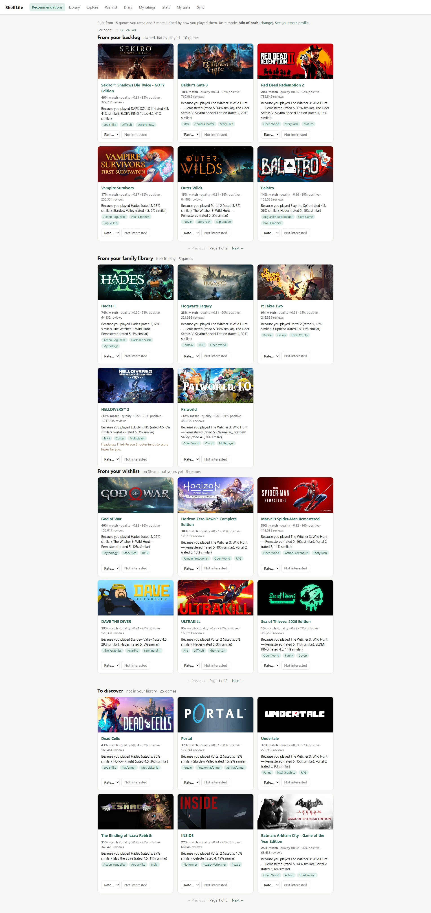
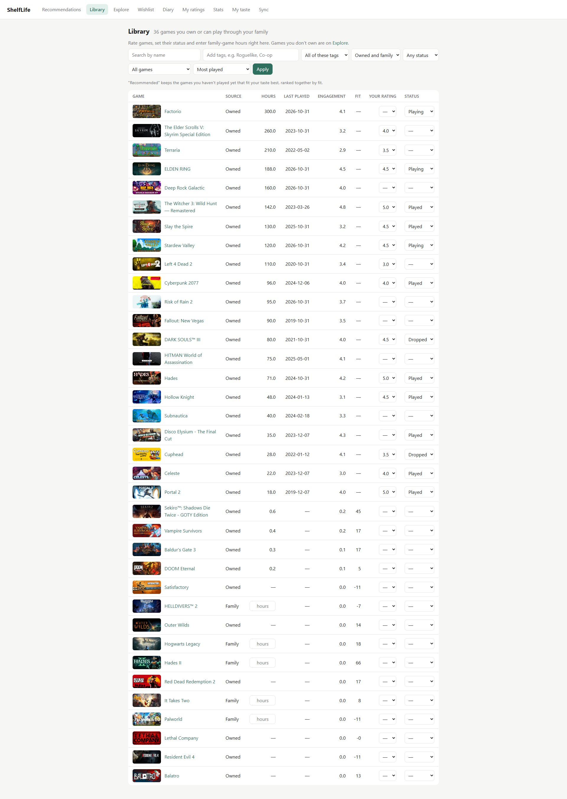
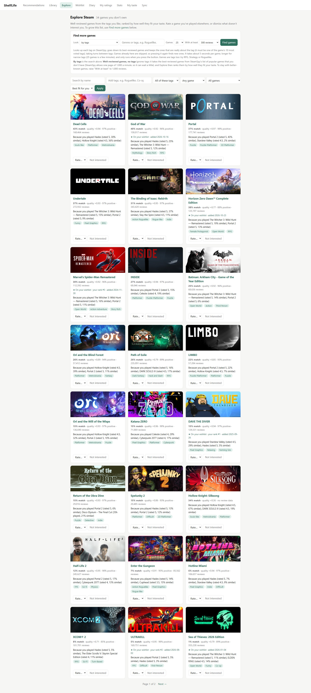
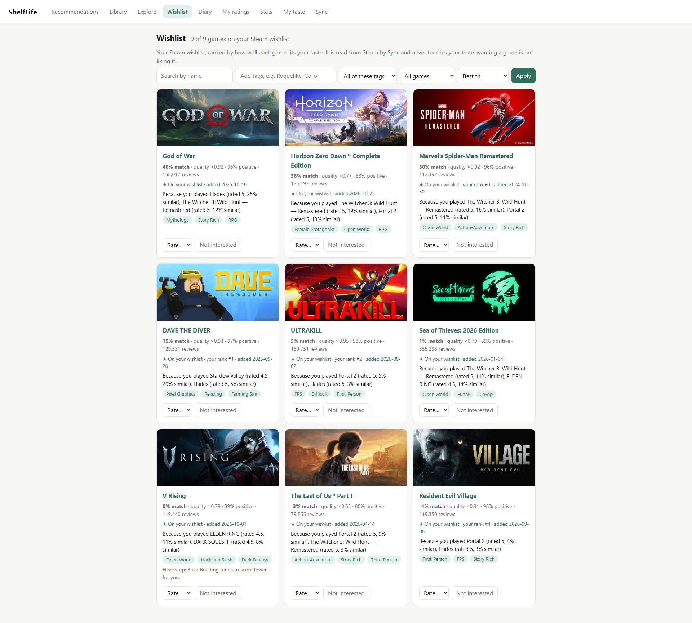
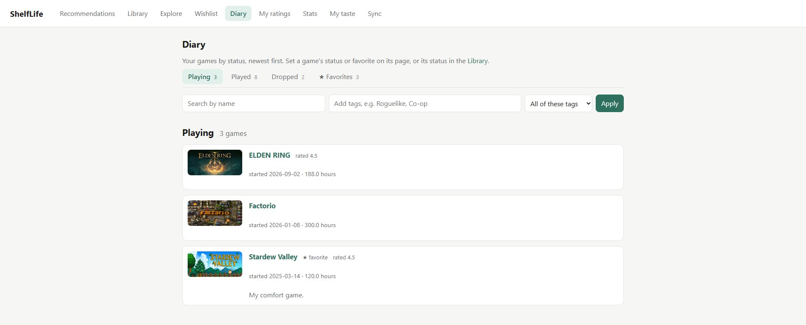
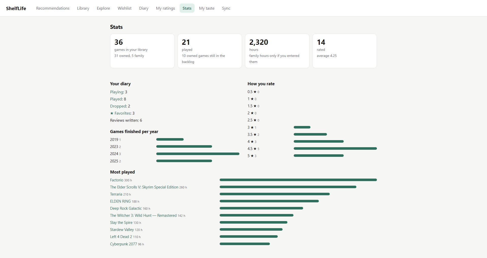
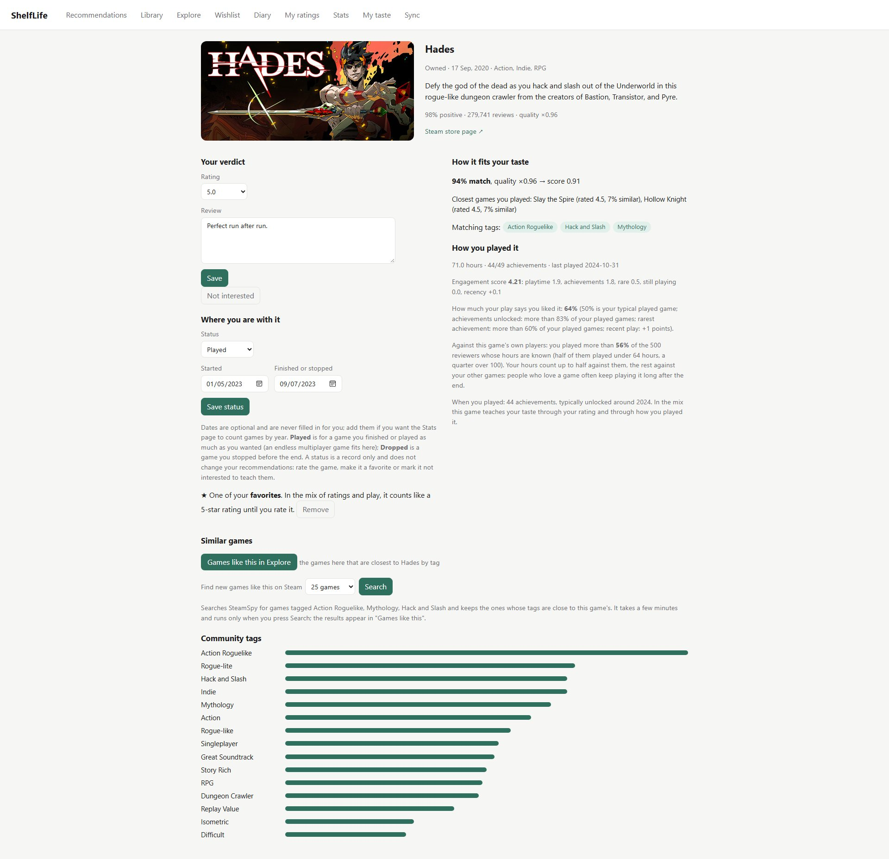
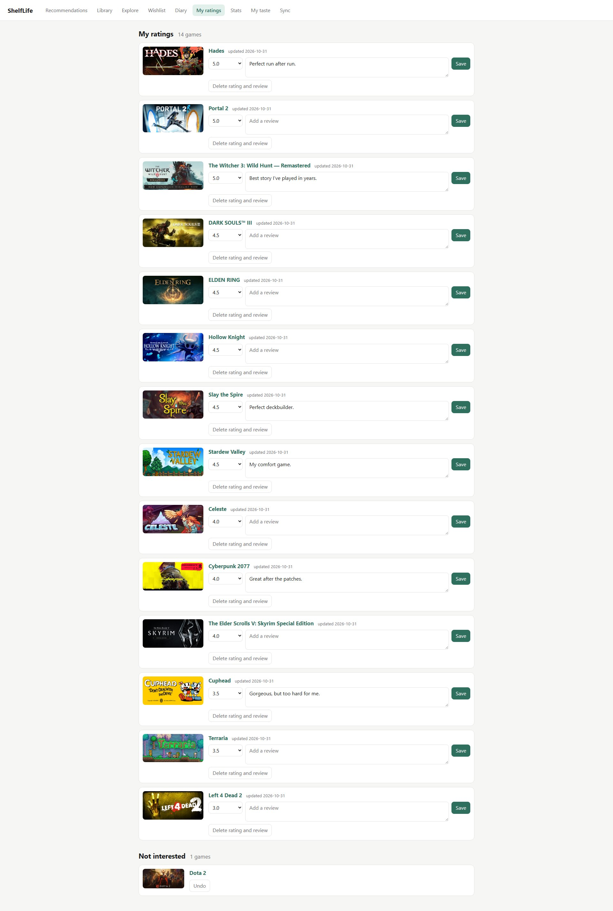
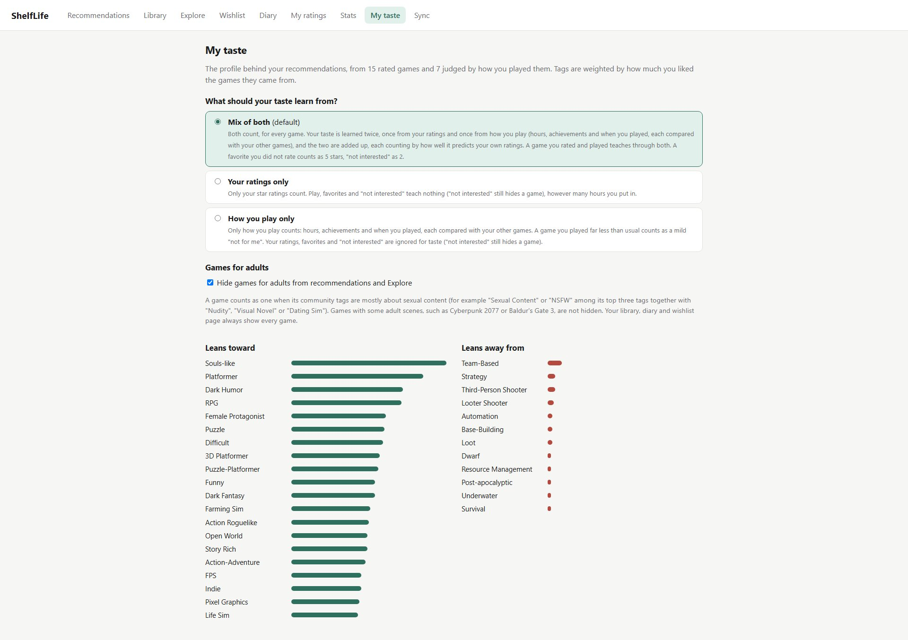
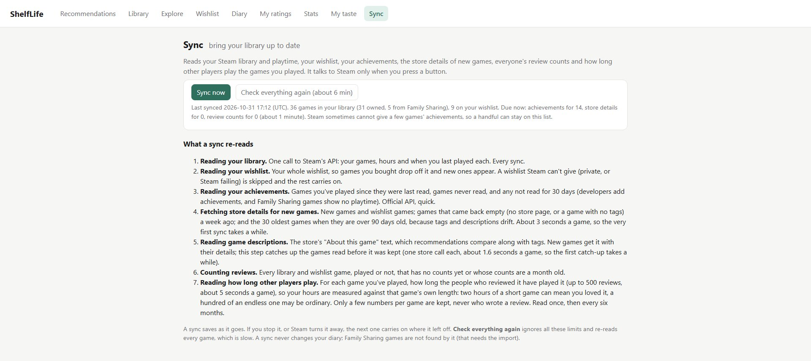

# ShelfLife

[](https://github.com/Antonetti-Lucas/shelflife/actions/workflows/tests.yml)
[](LICENSE)

> A Letterboxd-style game diary that imports your Steam library, uses your playtime and achievements to understand how you *really* play, and recommends what to play next.

**Status:** early development. It runs entirely on your own computer: nothing is hosted, and your data never leaves your machine.

Steam knows what you own and how long you've played, but not what you *thought* of a game, and it can't tell "I loved this 6-hour game" from "I gave up on this 150-hour RPG." ShelfLife combines your ratings with how you played each game (your hours against your other games and against how long the game's own players play it, your achievements, and when you played) into a taste it learns from your games one by one, then recommends games from your backlog, your Steam Family library, your wishlist and games you don't own yet.

## Features

- **Steam import:** owned games, playtime, store details and descriptions, community tags, review counts, achievements, and how long each game's players usually play it.
- **Family Sharing import** (optional): games you can play through a Steam Family.
- **Wishlist:** your Steam wishlist, read by Sync and ranked by how well each game fits you (it never teaches your taste).
- **Diary:** 0.5–5 star ratings, reviews, "not interested" marks, a status (playing, played, dropped) with dates, and favorites, stored locally.
- **Recommendations:** four lists (backlog, family, your wishlist, games you don't own), each pick with a reason. Learn from your ratings, from how you play, or from both.
- **Web app:** recommendations, a library you can rate and edit in place, an Explore page with a button to find more games, similar games for any game, a wishlist page, a diary, stats, game pages, your taste profile, a switch to hide games for adults, and a Sync button.

## Screenshots

Taken on demo data: popular Steam games with made-up playtime, ratings, diary entries and wishlist for an imaginary player.

**Recommendations**, in four lists (backlog, family library, your wishlist and games to discover), each pick with the games and tags behind it:



**Library**, with ratings, statuses and hours editable in the row:



**Explore**, for games you don't own: a panel to find more games from Steam, and a tag picker with "all of / any of":



**Wishlist**, read from Steam and ranked by how well each game fits your taste, with your own rank and when you added it:



**Diary**, one tab per status (playing, played, dropped, favorites) with your dates and reviews, and **Stats**:





**Game page**, showing why a game fits you, how much your play says you liked it (against your other games and against the game's own players), and where you are with it, and **My ratings**:





**My taste**, the tag profile behind it all, what it learns from, and the switch for games for adults, and **Sync**, which brings everything up to date in the background:





## Setup

You need Python 3.11 or newer, a Steam account, and a free Steam Web API key. (Developed on Python 3.15; the test workflow runs 3.11–3.13.)

**1. Install**

```bash
git clone <this repository>
cd <the repository folder>
python -m venv .venv
# Windows:      .venv\Scripts\activate
# macOS/Linux:  source .venv/bin/activate
pip install -r requirements.txt
```

**2. Get your Steam credentials**

- **API key:** create one at <https://steamcommunity.com/dev/apikey> (any domain name works, e.g. `localhost`). Keep it private.
- **SteamID:** your SteamID64, a 17-digit number (`XXXXXXXXXXXXXXXXX`). If your profile address has a number after `/profiles/`, that's it; otherwise paste your profile address into <https://steamid.io>.
- **Privacy:** in your Steam profile's *Privacy Settings*, set **Game details** to **Public** (and the wishlist too, if you want it read).

**3. Configure**

Copy `.env.example` to `.env` and fill it in. `.env` is git-ignored; never share it.

```
STEAM_API_KEY=your_key_here
STEAM_ID=your_64_bit_steam_id_here
```

**4. Run**

```bash
python -m scripts.web            # then open http://127.0.0.1:8000
```

Open the **Sync** page and press **Sync now**. It reads your library, wishlist, achievements, store details, game descriptions, review counts and how long other players play your games, in the background with a progress bar and a Stop button, and carries on where it left off if you stop it. It is deliberately slow to respect the services' limits, so the first sync of a few hundred games takes a while (the page says roughly how long); later syncs only re-read what could have changed. Then use **Find more games** on Explore to add games you don't own.

The same steps exist as command-line scripts (below), for example `python -m scripts.top_games` as a quick check that your key works. Your database is `shelflife.db` in the project folder, wherever you start ShelfLife from.

**If something goes wrong**

- *"No games returned"*: *Game details* isn't Public, or `STEAM_ID` isn't the 17-digit ID.
- *"Steam rejected the API key"*: check `STEAM_API_KEY`.
- *"rate limiting"*: wait a few minutes and sync again; nothing read so far is lost.
- *Start over*: delete `shelflife.db` (your ratings live in it) and sync again.

### Other commands

| Command | What it does |
|---|---|
| `python -m scripts.sync [--limit N] [--fill-tags] [--descriptions]` | Import the library; fetch details and tags; or read the store text of games that lack it |
| `python -m scripts.achievements` | Achievements and when you unlocked them |
| `python -m scripts.discover [--per-tag N] [--tags "A,B"]` | Find new games you don't own (the same as Explore's button) |
| `python -m scripts.wishlist` | Read your Steam wishlist (needs only your SteamID) |
| `python -m scripts.scores [N]` | Rank your played games by engagement score |
| `python -m scripts.recommend [N]` | Print recommendations in the terminal |
| `python -m scripts.feedback not-interested "Name"` | Dismiss a game (also `undo`, `list`) |
| `python -m scripts.import_family [file]` | Import a Family Sharing export (below) |
| `python -m scripts.hours [--template]` | Enter family-game hours from a file |
| `python -m scripts.import_diary` | One-time import of old `ratings.csv` / `feedback.csv` |

## Web app

`python -m scripts.web`, then open <http://127.0.0.1:8000>. It listens only on your own machine, answers only to `127.0.0.1` and `localhost`, and has no login, so don't expose it to a network. Run it as a single process.

- **Recommendations:** your backlog, family, wishlist and discovery lists, paged, each pick with the games and tags behind it. Rate or dismiss from the card.
- **Library:** your owned and family games with covers. Set a rating or a status, or type hours for family games, right in the row. Search by name, filter by tags or status, sort by most played or **recently played**, or use the **Recommended** filter to keep the unplayed games that fit you best (top 50%, 25% or 10%).
- **Wishlist:** your Steam wishlist ranked by how well each game fits your taste, with your own rank and the date you added each one. Search, the tag picker and the best-fit cut work as in Explore, and you can sort by fit, your own order, newest added, reviews or name. It is read by Sync (the wishlist must be public on Steam) and only shows games whose store details have arrived. Wishlisted games also get a badge and an "only my wishlist" filter in Explore, a "From your wishlist" list on the home page (instead of in "To discover"), and a note on their game page. Wanting a game is not liking it, so a wishlist never changes your taste.
- **Explore:** games you don't own, ranked by fit, with the same filter, search, tags and sorting. **Find more games** adds new ones for the genres or tags you pick (or the tags you like most), or with no tags at all (the best-reviewed games from SteamSpy's list of popular games), for a number of games you choose, and shows its progress. Every game page has **Games like this** (Explore ranked by how close games are to that one) and a button to search Steam for new games like it.
- **Diary:** one tab each for playing, played, dropped and your favorites, newest first, paged, with search and a tag filter. Set a status, optional dates and a favorite on a game's page; dates are never filled in for you. "Played" means finished or played as much as you wanted, so it fits endless multiplayer games too.
- **Tags:** pick several tags in the Library, Explore or Diary, and choose whether a game needs all of them or any of them. Tags match whole and ignore case, a game "has" a tag if it is among its 20 most voted, and the box suggests the tags that exist.
- **Sync:** one button, seven steps: your library, wishlist, achievements, store details, game descriptions, review counts, and how long other players play each game you've played. A sync re-reads what could have changed: achievements for games you played since they were last read, or not read for 30 days; store details for new games, games that came back empty a week ago, and the 30 oldest when they are over 90 days old; descriptions once; review counts a month old; other players' hours every six months. **Check everything again** ignores those limits (slow, and the page says how long). It saves as it goes, needs `STEAM_API_KEY` and `STEAM_ID` in `.env`, and never runs at the same time as a game search.
- **Stats:** games and hours in your library, your diary by status, games finished per year, how you rate, and your most played games.
- **Game page:** why a game fits you, the closest games you liked, how you played it (and how much that play says you liked it, against your other games and the game's own players), your verdict, status and favorite.
- **My ratings:** your ratings and reviews, paged, to edit or delete in place, and the games you marked "not interested".
- **My taste:** the tags your taste leans toward and away from, what it learns from (your ratings, how you play, or both), and **Hide games for adults** (on by default): games whose community tags are mostly about sexual content are left out of recommendations and Explore, while games that merely have adult scenes (Cyberpunk 2077, Baldur's Gate 3) stay. Your library, diary and wishlist page always show every game.

## Family Sharing (optional)

Steam's Web API only lists games on your own account. ShelfLife imports Family Sharing games the way SteamDB's browser extension does, with a script **you run yourself**, so your login token never touches ShelfLife:

1. Log in at <https://store.steampowered.com>, open DevTools (F12) > Console, paste [`tools/export_family_library.js`](tools/export_family_library.js) and press Enter. It downloads `family-library.json`.
2. Put that file in a `data/` folder (create it) and run `python -m scripts.import_family`.
3. Sync again.

The script gets a short-lived token from the Steam store using your own cookies and calls `IFamilyGroupsService/GetSharedLibraryApps`. The token stays in the tab's memory and is never printed, saved or sent anywhere. These endpoints are undocumented by Valve and may change. The export lists which games your family members own, so keep it private.

**Hours.** Steam reports no playtime for family games, so enter what your Steam client shows: in the hours box on the game's page or in the Library, or in bulk with `python -m scripts.hours --template` (fill in `data/hours.csv`, then run `python -m scripts.hours`). Hours only apply to family games.

## Data and terms

Data comes from the Steam Web API (library, playtime, achievements), the Steam store (details, descriptions, covers), Valve's `IUserReviewsService` (review counts, and how long reviewers played), and SteamSpy (community tags, 1 request/second). ShelfLife follows the [Steam Web API Terms of Use](https://steamcommunity.com/dev/apiterms): your key stays in `.env` on your machine, data is fetched only when you run a command or press a button, everything is stored locally, and it is not affiliated with or endorsed by Valve. A few endpoints used are undocumented and may change (see Privacy).

Personal data lives in `shelflife.db`, `.env` and the `data/` folder, all git-ignored.

## Privacy

ShelfLife runs entirely on your own computer. It has no server, no account, no analytics and no tracking, and your diary never leaves your machine.

**What it stores, and where**

- `.env`: your Steam API key and SteamID.
- `shelflife.db`: your library (games, hours, when you last played, achievement counts and when you unlocked them), your wishlist (game ids, your own rank and the date you added each), the hours you type in for family games, which games are shared with you through Family Sharing, your diary (ratings, reviews, statuses and dates, favorites, "not interested"), your settings, and public store data for each game (names, descriptions including the store's "About this game" text, tags, review counts, cover addresses, and five numbers summarising how long its reviewers have played it; never who wrote a review or what it says).
- `data/`: files you create or import, such as the Family Sharing export (it lists which games your family members own, so keep it private) and old CSV files.

Delete `.env`, `shelflife.db` and `data/` and nothing of yours is left.

**What it sends, and to whom** (only when you run a command or press a button)

- **Valve's Steam Web API** (`api.steampowered.com`): your API key and SteamID, to read your own library and achievements, and your key to look up game names. Your SteamID alone (no key) is sent to read your wishlist. Review counts, reviewers' hours and global achievement rates are asked for by game id alone.
- **The Steam store** (`store.steampowered.com`) and **SteamSpy** (`steamspy.com`): game ids and tag names only. They never receive your key, SteamID, ratings or diary.
- **Your browser** loads cover images from Steam's servers when you open a page.
- Nothing else: no outside fonts, scripts or analytics. The web app listens only on `127.0.0.1`, answers only to `127.0.0.1` and `localhost` (so another website can't reach it by pointing its own name at your computer), and has no login, so don't expose it to a network.

**Steam's terms**

ShelfLife is a personal tool. Each person uses their own API key (it is personal to you, so don't share it or commit it) to read their own account, within Valve's limit of 100,000 calls a day (a full sync uses a few hundred, plus up to five review pages a game for players' hours), and it is not affiliated with or endorsed by Valve. The [Steam Web API Terms of Use](https://steamcommunity.com/dev/apiterms) ask applications to say what Steam data they store; the list above is that statement.

Most of what ShelfLife reads comes from Valve's documented Web API. A few things come from endpoints Valve doesn't document: the store's `appdetails` endpoint, the reviews (counts and reviewers' hours), the tag votes read from a game's store page when SteamSpy has none, your wishlist (`IWishlistService`), and the Family Sharing export. They are read-only lookups, throttled and run only when you ask (the family export reads only your own account). Because they are undocumented they may change or stop working, and the [Steam Subscriber Agreement](https://store.steampowered.com/subscriber_agreement/) has a general rule about bots and scripts on Steam, whose examples are about cheating and account abuse. Using them is your choice; only the Family Sharing import is optional.

Game names, store data and cover art belong to Valve and the game publishers. The licence below covers ShelfLife's code only.

## How recommendations work

**1. How much your play says you liked a game** (`shelflife/play.py`). Hours alone mislead: two hours can be all of a short game, and a hundred hours of an endless one can be ordinary. So each signal is placed among comparable play, as a percentile:

| Signal | Compared with |
|---|---|
| Hours | your other played games, and (up to half) the hours the game's own reviewers have played it |
| Achievements unlocked | your other games (games with 10+ achievements) |
| Rarest achievement you hold | your other games (rarer = more devoted) |
| When you played | a small shift up for current play, down for play long past, from your achievement unlock dates |

A game's play score is the average of the signals it has (a missing one is left out, not counted as zero), so 50% is your typical played game. Other players' hours come from up to 500 of the game's reviews, positive and negative reviewers weighed by the game's real share, kept as percentiles so a few players with thousands of idle hours move only the top end. They count for at most half, because people who love a game keep playing it long after the end. Games under an hour are your backlog, not a verdict.

The older **engagement score** (`shelflife/score.py`: points for hours, achievements, rare achievements, current play and recency) is still shown in the Library and on game pages.

**2. What your taste learns from.** Your choice, on the My taste page:

- *Your ratings only*: star ratings, `(rating − 3) / 2`, from −1 to +1. Nothing else.
- *How you play only*: the play score of every game you played, from −0.5 (far less than usual) to +1 (far more), 0 being your typical game. Ratings, favorites and "not interested" are ignored.
- *Mix of both* (the default): a taste learned from your ratings and a taste learned from your play, added up. Each counts by how much of your ratings it explains, measured with every rated game left out in turn (its squared correlation with them), starting from two thirds ratings, one third play until there are enough ratings to tell. Here a favorite you didn't rate counts as 5 stars and "not interested" as 2.

A status (playing, played, dropped) is a record only: it takes the game out of the recommendations but never changes your taste. "Not interested" always hides the game.

**3. Learning your taste** (`shelflife/learned.py`). Every game is described two ways: by its tags, each counting by how relevant it is to the game (its votes relative to the game's top tag, squared, for the top 15 tags) and how rare it is in your library; and by the words of the store's "About this game" text that tell games apart (store boilerplate dropped; words used by at least 3 games and at most 15% of them; a description left with fewer than 20 such words, such as one written in another script, counts as none). Two games are as alike as those descriptions are, half tags and half words, so two games with different tags but the same story still match, and a sequel matches its original by the names they share. A ridge regression then learns, from every game you have a verdict on, which kinds of games you like, and predicts that for every other game. Because it is fitted to your games one by one, a game very close to a favourite stays close to it. Nothing is sent anywhere: it is a few hundred games of arithmetic, kept between pages until your data changes.

**How good is it?** `python tools/evaluate.py` predicts every game you rated (and every game you ranked, if you keep `data/rankings.csv`) with everything about that game left out, and compares the predictions with your own verdicts. On the owner's 144 ratings the rank correlation is about +0.43 for ratings only, +0.41 for the mix, and +0.12 for play alone: play is a weak guide to how you'd rate a game, which is why the mix gives it a small share. One person's games, so take the exact numbers lightly.

**4. Finding new games.** Explore's **Find more games** button (and `python -m scripts.discover`) works like this: SteamSpy lists every game under a tag, with its review counts. That list is loose (any game with even a few votes for the tag is in it), so games you already have and games with under 300 reviews are dropped, the rest are ranked by the lower bound of their positive-review share (more reviews rank higher at equal praise), and then, going down the ranking with the tags taking turns, each game's own tag votes are read and the game is kept only if the searched tag is among its 10 most voted. The others are remembered, with their tags, so they are not fetched again. Kept games get their store details fetched, about 5 seconds a game in all, and then take part in the rankings. For "games like this one", the tags searched are that game's most distinctive ones and a game must also be at least 15% similar to it. SteamSpy matches tag names in a particular letter case (and a few under older names), so several spellings are tried. Without tags, the search reads SteamSpy's popularity-ordered list instead (up to 3 pages of 1,000 games, a minute apart as SteamSpy asks, and only as many as needed) and keeps the best-reviewed games you don't have, with no tag check.

**5. Scoring.**

```
score = predicted_liking(game) × quality
quality = (Wilson lower bound of the positive-review share) ^ 2
```

The predicted liking, stretched so that a close match reads as one, is shown as the "match" on every pick; it is 0 for a game unlike anything you have a verdict on, and below 0 for one that resembles games you did not like. The Wilson bound is cautious with few reviews: about 0.9 at 95% positive, 0.5 at 70%, 0.36 with no review data. Candidates are backlog games (owned, under an hour played), family games you haven't played, and games you don't own (300+ reviews); other editions of games you already have are skipped, and so are games for adults while that switch is on.

## Development

```bash
pip install -r requirements-dev.txt
python -m pytest
```

The tests use a temporary database and folder (never your own data) and can't reach the network: any call that gets past the fakes fails the test. Stack: Python, FastAPI with Jinja templates, SQLite through SQLAlchemy, pytest, GitHub Actions. The data model is in `shelflife/models.py`. `python tools/evaluate.py` measures how well the taste predicts your own ratings (see above), so a change to the scoring can be judged by numbers.

To regenerate the screenshots, `python tools/make_demo_db.py demo.db` builds the demo database (real games fetched from Steam; made-up play history, ratings, diary entries and wishlist), and `DATABASE_URL=sqlite:///demo.db python -m scripts.web --port 8001` runs the app on it. For the Sync page to show its buttons, also set any placeholder `STEAM_API_KEY` and `STEAM_ID` for that run; nothing is sent unless you press a button.

## License

[MIT](LICENSE). This covers the code only; data from Steam and other services stays under their own terms.
