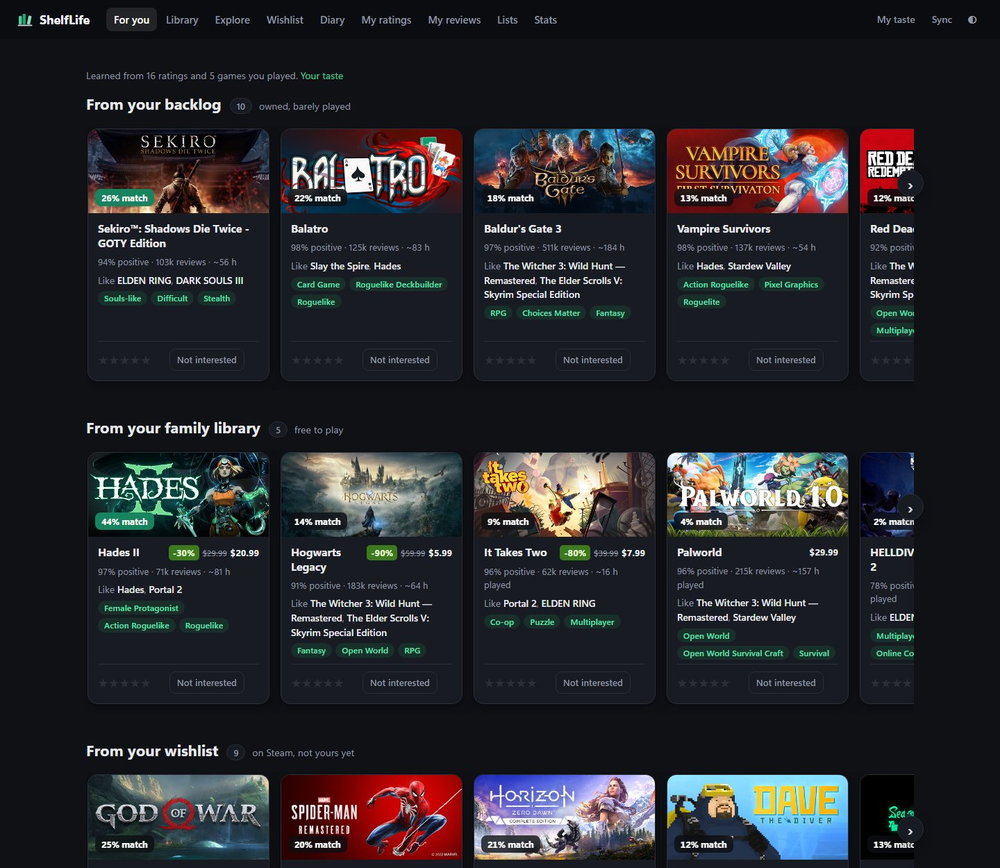
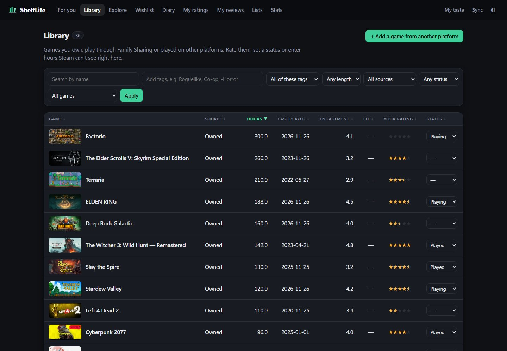
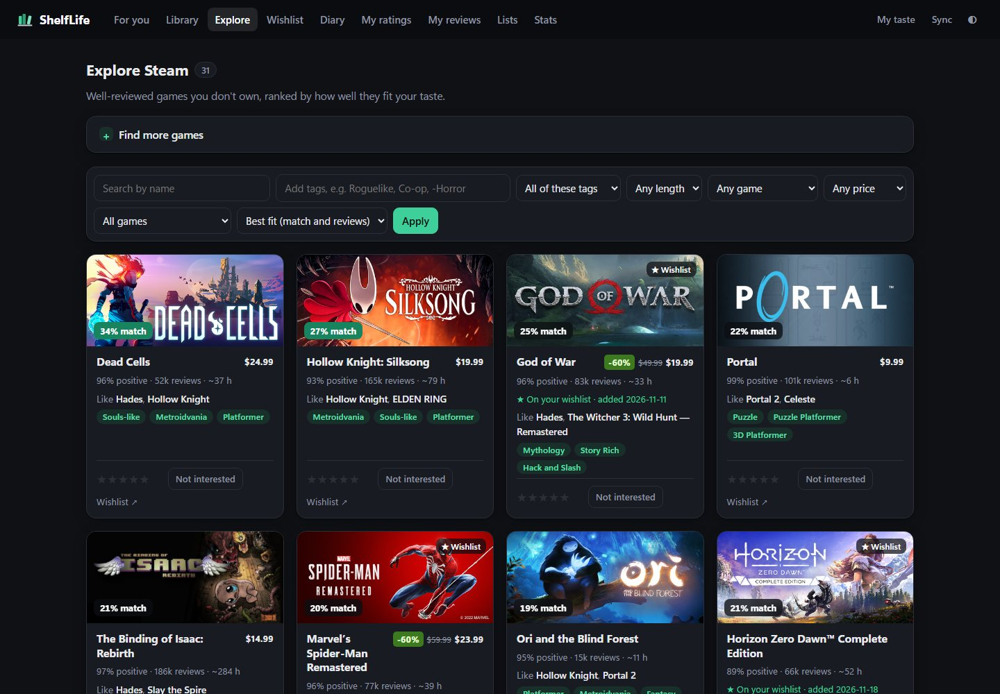
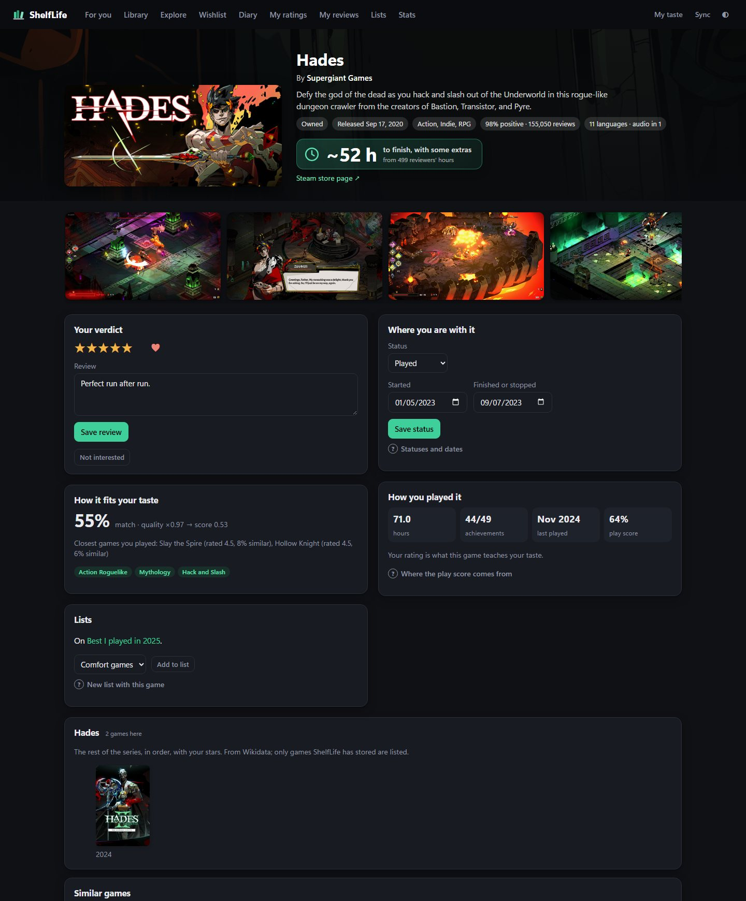
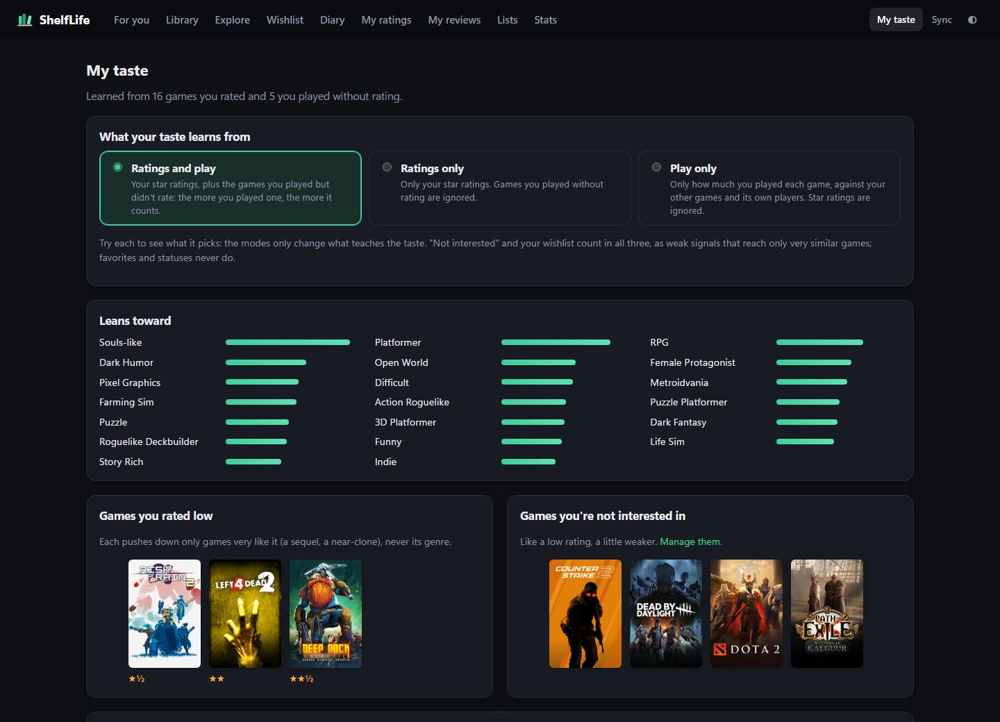
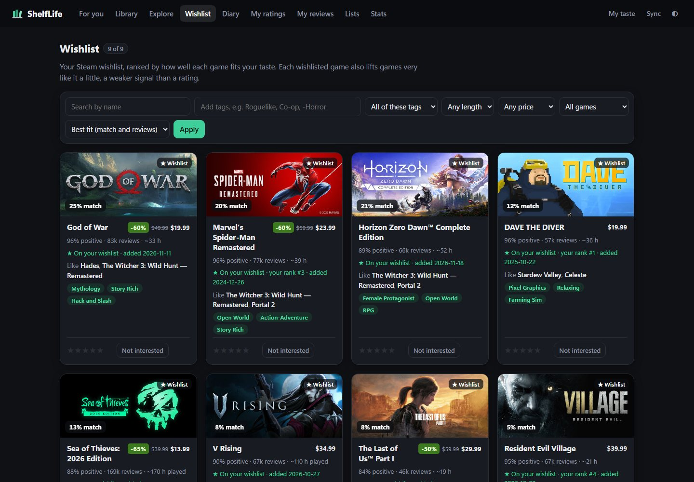
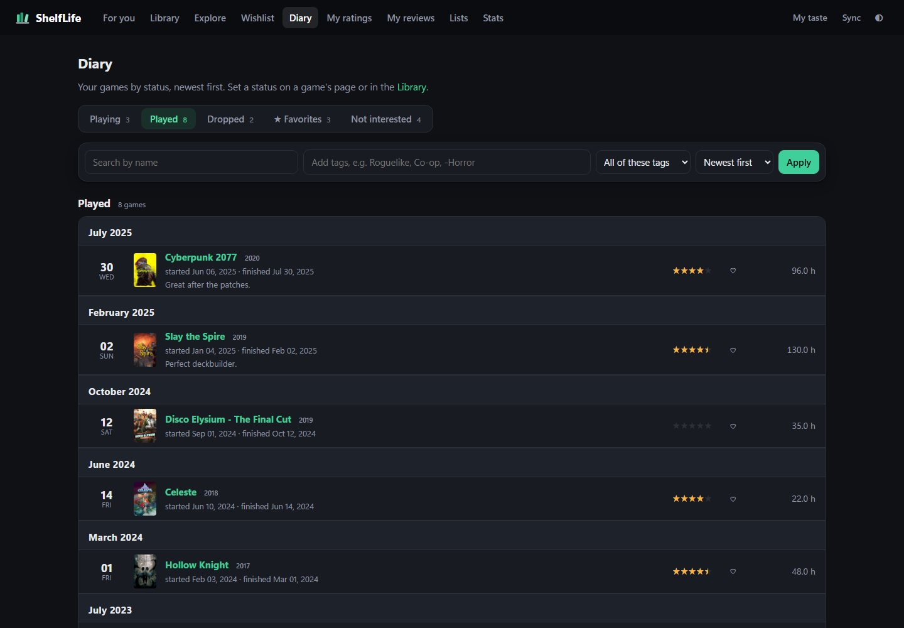
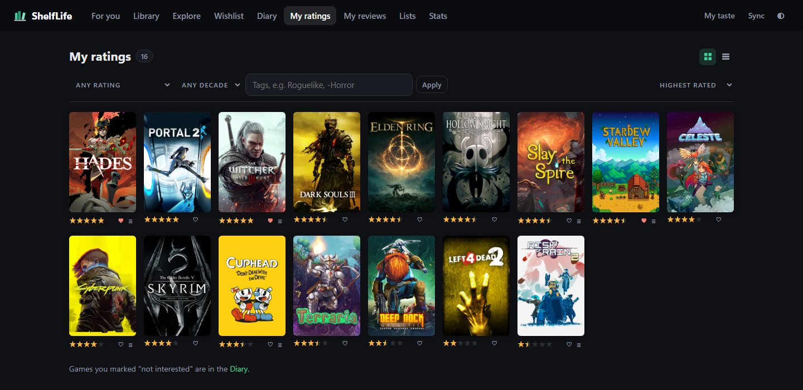
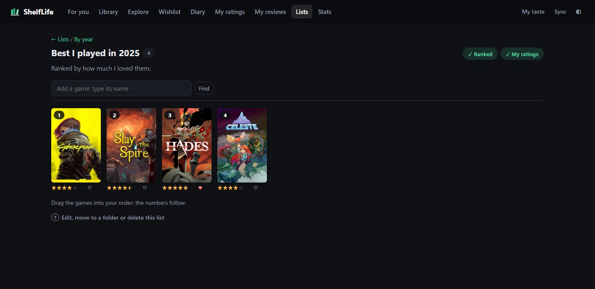
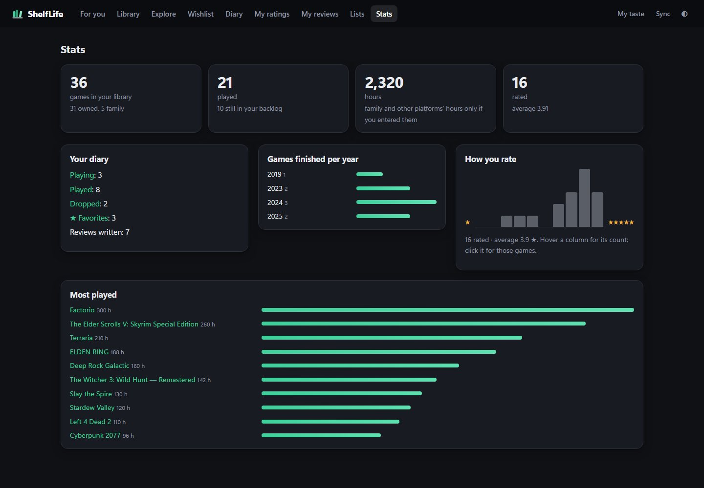

# ShelfLife

[](https://github.com/Antonetti-Lucas/shelflife/actions/workflows/tests.yml)
[](LICENSE)

> A Letterboxd-style game diary for your Steam library that learns how you *really* play and tells you what to play next.



Steam knows what you own and how long you've played, but not what you *thought* of a game, and it can't tell "I loved this 6-hour game" from "I gave up on this 150-hour RPG." ShelfLife combines your ratings with how you played each game (your hours against your other games and against the game's own players, your achievements, and when you played) into a taste it learns from your games one by one. Then it recommends games from your backlog, your Steam Family library, your wishlist and the games you don't own yet.

It runs entirely on your own computer: nothing is hosted, and your diary never leaves your machine. **Status:** early development.

## How it works

1. **Sync** reads your Steam library, hours, achievements and wishlist, then each game's public store data (tags, reviews, price, languages) and, from Wikidata, its series and first release date. Later syncs ask Steam which games changed and re-read those first. Family Sharing games and games from other platforms can be added too, including games that aren't on Steam at all (from IGDB).
2. **You log and rate** in the diary: half stars, reviews, statuses with dates, favorites. Your star ratings are what teach the taste, and so, if you choose, is how you played (your hours against your other games and against the game's own players, achievements, and when you played).
3. **It learns your taste** from those games. A high rating pulls up games with similar tags; a low one pushes down only close look-alikes (a sequel, a near-clone), never a whole genre. Favorites, statuses and lists never teach it; your wishlist and "not interested" count only weakly.
4. **It scores everything you could play next** by how well its tags match your taste, adjusted for how well the game is reviewed, and shows the picks in four lists (backlog, Steam Family, wishlist, new games), each with the games and tags behind it.
5. **Explore finds games you don't own** through Steam's own tag and popularity lists (SteamSpy only if Steam can't be reached), then ranks them by fit. Nothing is added to your Steam account: you open a game's store page to wishlist or buy it.

All of it runs on your computer, and the details are in [How recommendations work](docs/how-it-works.md).

## Features

- **Steam import:** your library, playtime, achievements and wishlist, plus Family Sharing games if you want them, and games you played on consoles or other stores, added by hand. Games that were never on Steam (an Atari, PlayStation or Wii game) come from IGDB, with tags made from its genres and themes that you can change, and teach your taste like any game.
- **A diary:** half-star ratings, reviews, statuses with dates (playing, played, dropped) listed by month like Letterboxd's, favorites and "not interested", with a poster wall of everything you rated and a page of your reviews.
- **Lists you make and name:** ranked or not, with your stars under each game or not, in the order you drag them into, and kept in folders.
- **Series:** a game's page lists the rest of its series in order, with your stars, and the decade filter counts a port or remaster from its first release.
- **Recommendations** in four lists (backlog, family, wishlist, games to discover), each pick showing the games and tags behind it. Learn from ratings and play, ratings only, or play only.
- **Explore and find new games** by Steam tags, the best-reviewed popular games with no tag, or "games like this one", ranked by how well they fit you. Explore and your wishlist can also be sorted by lowest price or biggest discount, or narrowed to games on sale.
- **Store info where you need it:** prices in your currency (kept fresh on screen), each game's lowest price ever on Steam with a "Lowest ever" flag when a sale matches it (from IsThereAnyDeal, with your own free key), estimated length, languages, developer, release date and screenshots.
- **Stats and a taste profile**, a language filter, switches to hide games for adults and tools that aren't games (Blender, Aseprite), light or dark, a setup page for your Steam key, and on Windows an app window with its own icon instead of a browser tab.

## Quick start

You need Python 3.11 or newer, a Steam account and a free Steam Web API key.

**1. Install**

```bash
git clone https://github.com/Antonetti-Lucas/shelflife.git
cd shelflife
python -m venv .venv
# Windows:      .venv\Scripts\activate
# macOS/Linux:  source .venv/bin/activate
pip install -r requirements.txt
```

**2. Run it and connect your Steam account**

```bash
python -m scripts.web
```

Open <http://127.0.0.1:8000>. The first time, it shows a short setup page (every page links to it until you finish) that asks for:

- **A Steam Web API key:** free, made at <https://steamcommunity.com/dev/apikey> (any domain name works, e.g. `localhost`).
- **Your Steam profile:** paste your profile's address (`steamcommunity.com/id/yourname` or `.../profiles/7656...`) or your 17-digit SteamID.
- **Your country** (optional): two letters, so prices come in your currency.

It checks them with Steam, saves them to a `.env` file in the project folder (git-ignored; never share it) and uses them at once. In your Steam profile's *Privacy Settings*, set **Game details** to **Public** (and the wishlist too, if you want it read).

Prefer to do it by hand? Copy `.env.example` to `.env`, fill in `STEAM_API_KEY`, `STEAM_ID` and optionally `STEAM_COUNTRY`, and restart.

**3. Press Sync**

Go to **Sync** and press **Sync now**. It reads everything in the background, with a progress bar and a Stop button. The first sync of a few hundred games takes a while, because it's deliberately slow to respect Steam's limits; later ones only re-read what could have changed. Then use **Find more games** on Explore to add games you don't own.

**On Windows, as an app (optional).** To skip the command and the browser: `pip install -r requirements-app.txt`, then `python tools/make_shortcut.py` (add `--desktop` for your Desktop) makes a **ShelfLife** shortcut with its icon that opens the app in its own window; `python -m scripts.app` does the same. Only one window opens at a time, and closing it stops the app (it asks first if a Sync or search is still running). Pin the shortcut to your taskbar if you like.

## Screenshots

Taken on demo data: popular Steam games with made-up playtime, ratings and diary for an imaginary player.

| | |
|---|---|
|  **Library:** rate, set a status and sort in place |  **Explore:** games you don't own, ranked by fit, with prices, length and sales |
|  **Game page:** why it fits you, how you played it, and the rest of its series |  **My taste:** what your taste learns from, leans toward and steers away from |
|  **Wishlist:** ranked by how well each game fits you |  **Diary:** what you played, month by month |
|  **My ratings:** a poster wall you can rate on |  **Lists:** your own, ranked or not |
|  **Stats:** your library and diary in numbers | |

## Learn more

- **[Using ShelfLife](docs/guide.md):** every page, what Sync reads, the command-line scripts, Family Sharing, and troubleshooting.
- **[How recommendations work](docs/how-it-works.md):** the play score, what your taste learns from, the model, finding new games and scoring.

## Privacy

ShelfLife has no server, no account, no analytics and no tracking.

**What it stores, and where**

- `.env`: your Steam API key and SteamID, and your IGDB (Twitch) client id and secret and IsThereAnyDeal key if you set them.
- `shelflife.db`: your library (games, hours, when you last played, achievement counts and when you unlocked them), your wishlist (game ids, your own rank and the date you added each), the hours you type in for family games, which games are shared with you through Family Sharing, the games you added from other platforms (which platform, and the hours you type; for a game that isn't on Steam, what IGDB says about it: name, cover address, summary and storyline, genres, themes, keywords, platforms, rating, and the tags you give it), your diary (ratings, reviews, statuses and dates, favorites, "not interested"), your lists, your settings, and public store data for each game (names, descriptions, tags, review counts, cover addresses, five numbers summarising how long its reviewers have played it, its languages, store details and its price when last read, and, with an IsThereAnyDeal key, its lowest price ever on Steam and its IsThereAnyDeal id; never who wrote a review or what it says).
- `data/`: files you create or import, such as the Family Sharing export (it lists which games your family members own, so keep it private), and `data/window/`, where the app window keeps its own browser storage (just your light or dark choice).

All three are git-ignored. Delete them and nothing of yours is left.

**What it sends, and to whom** (only when you run a command or press a button)

- **Valve's Steam Web API** (`api.steampowered.com`): your API key and SteamID, to read your own library and achievements, and your key to look up game names. On the setup page, your key with the profile name or SteamID you typed, to find your SteamID and check that the key works. On each sync, your key to ask Steam's store change list (`IStoreService/GetAppList`, documented by Valve) which games changed since the last sync; it sends only a time, and receives game ids. Your SteamID alone (no key) is sent to read your wishlist. Review counts, reviewers' hours, global achievement rates and tags are asked for by game id or tag alone, and a game you add from another platform by the name or link you type.
- **The Steam store** (`store.steampowered.com`) and **SteamSpy** (`steamspy.com`): game ids, tag names and your `STEAM_COUNTRY` only. They never receive your key, SteamID, ratings or diary.
- **Wikidata** (`query.wikidata.org`): Steam game ids only, to learn which series a game belongs to and when it was first released. Its data is public (CC0). The request names ShelfLife and its public repository in its User-Agent, as Wikidata asks, and nothing about you.
- **IGDB** (`api.igdb.com`, with a token from `id.twitch.tv`): only if you set `IGDB_CLIENT_ID` and `IGDB_CLIENT_SECRET`, and only when you search for a game that isn't on Steam: the name you type, and the IGDB id of the game you add. Twitch receives your client id and secret to issue the token, which is kept in memory only.
- **IsThereAnyDeal** (`api.isthereanydeal.com`): only if you set `ITAD_API_KEY`, on each sync: your key, Steam game ids of games you don't own, their IsThereAnyDeal ids and your `STEAM_COUNTRY`, to read each game's lowest price ever on Steam.
- **Your browser** loads cover images and screenshots from Steam's servers when you open a page, and the covers of games that aren't on Steam from IGDB's (`images.igdb.com`).
- Nothing else: no outside fonts, scripts or analytics. The web app listens only on `127.0.0.1`, answers only to `127.0.0.1` and `localhost` (so another website can't reach it by pointing its own name at your computer), and has no login, so don't expose it to a network.

**Steam's terms**

ShelfLife is a personal tool. Each person uses their own API key (it is personal to you, so don't share it or commit it) to read their own account, within Valve's limit of 100,000 calls a day (a full sync uses a few hundred, plus up to five review pages a game for players' hours). It follows the [Steam Web API Terms of Use](https://steamcommunity.com/dev/apiterms), which ask applications to say what Steam data they store; the list above is that statement. It is not affiliated with or endorsed by Valve.

Most of what ShelfLife reads comes from Valve's documented Web API. A few things come from endpoints Valve doesn't document: the store's `appdetails` endpoint, the reviews (counts and reviewers' hours), the store's tag and search services (`IStoreBrowseService` for games' tags, `IStoreQueryService` for the games under a tag, for the popular games and for finding a game by name), the tag votes on a game's store page when neither Steam nor SteamSpy has any, your wishlist (`IWishlistService`), and the Family Sharing export. They are read-only lookups, throttled and run only when you ask (the family export reads only your own account). Because they are undocumented they may change or stop working, and the [Steam Subscriber Agreement](https://store.steampowered.com/subscriber_agreement/) has a general rule about bots and scripts on Steam, whose examples are about cheating and account abuse. Using them is your choice; only the Family Sharing import is optional.

Game names, store data and cover art belong to Valve and the game publishers.

**IGDB's terms**

IGDB is free for non-commercial use under the [Twitch Developer Services Agreement](https://www.twitch.tv/p/legal/developer-agreement/); you need your own Twitch developer app (a client id and secret, put in `.env`). IGDB's own documentation says storing its data locally is allowed. ShelfLife keeps it only in your own database, credits IGDB on the pages that show it, and the repository contains none of it. It is not affiliated with or endorsed by IGDB or Twitch.

**IsThereAnyDeal's terms**

The [IsThereAnyDeal API terms](https://github.com/IsThereAnyDeal/API/blob/master/TERMS_OF_SERVICE.md) allow apps that are available to the public, ask for credit (the pages showing its data link to it), and forbid changing its data or competing with IsThereAnyDeal; ShelfLife shows only Steam's own lowest price, as given. Each person uses their own key (register an app at [isthereanydeal.com/apps/my](https://isthereanydeal.com/apps/my/)). It is not affiliated with or endorsed by IsThereAnyDeal.

## Development

```bash
pip install -r requirements-dev.txt
python -m pytest
```

The tests use a temporary database and folder (never your own data) and can't reach the network: any call that gets past the fakes fails the test. Stack: Python, FastAPI with Jinja templates, SQLite through SQLAlchemy, pytest, GitHub Actions. The data model is in `shelflife/models.py`; after changing it, add a migration with `python -m alembic revision --autogenerate -m "what changed"` (read the file it writes), and a test checks that the migrations and the models agree. `requirements.lock` and `requirements-dev.lock` pin exact versions (regenerate with pip-tools' `pip-compile`); CI tests the newest allowed versions on Python 3.11–3.15 and the locked ones on 3.15. `python tools/evaluate.py` measures how well the taste predicts your own ratings, so a change to the scoring can be judged by numbers.

To regenerate the screenshots, `STEAM_COUNTRY=US python tools/make_demo_db.py demo.db` builds the demo database (real games, prices and reviews fetched from Steam, series from Wikidata; made-up play history, ratings, diary, lists and wishlist), and `DATABASE_URL=sqlite:///demo.db python -m scripts.web --port 8001` runs the app on it. For the Sync page to show its buttons, also set any placeholder `STEAM_API_KEY` and `STEAM_ID` for that run; nothing is sent unless you press a button. The pictures are taken in the dark theme, 1440 pixels wide.

## License

[MIT](LICENSE). This covers the code only; data from Steam and other services stays under their own terms.
