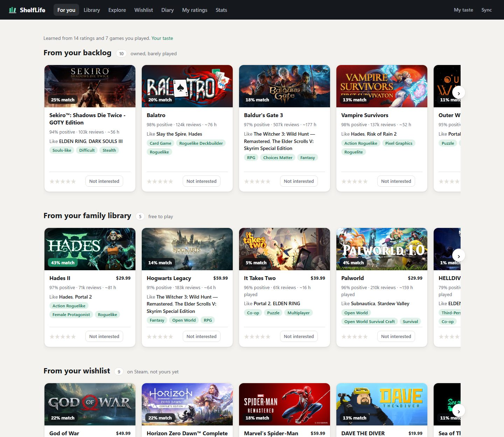
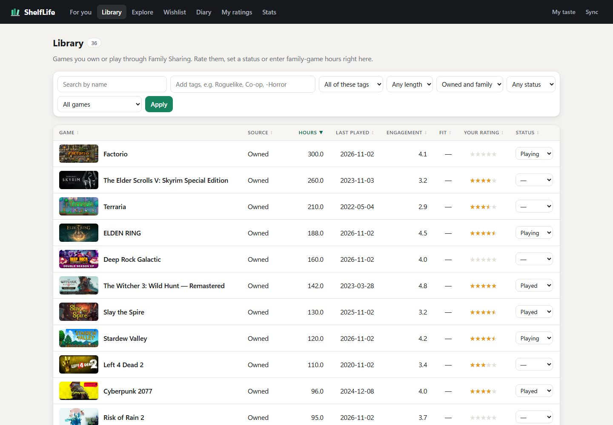
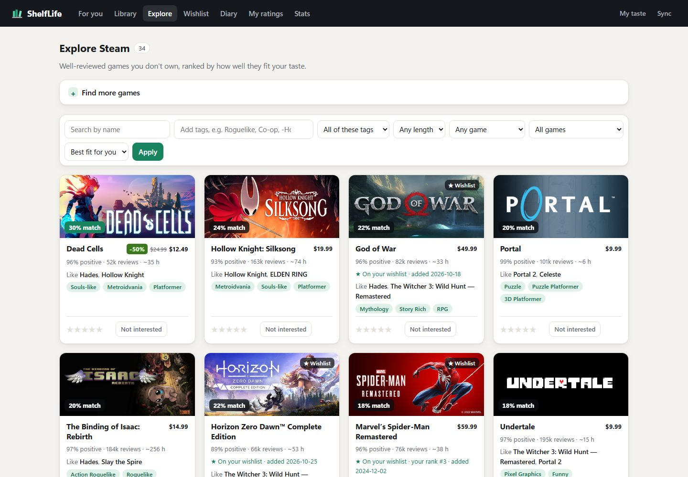
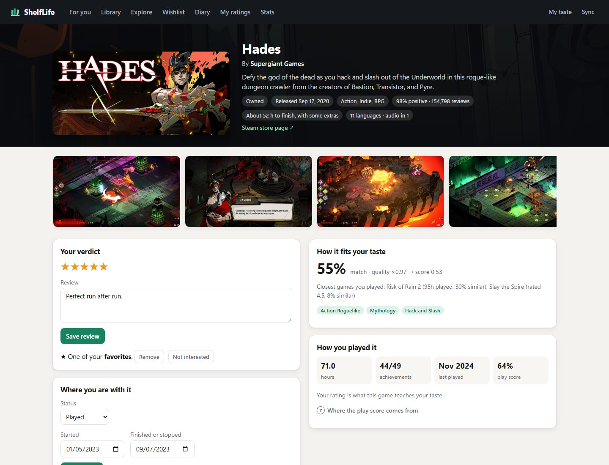
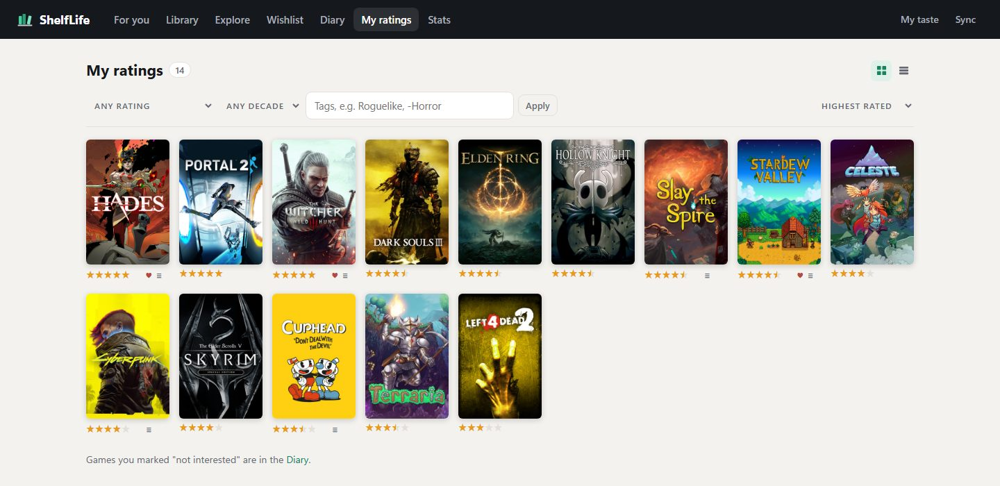
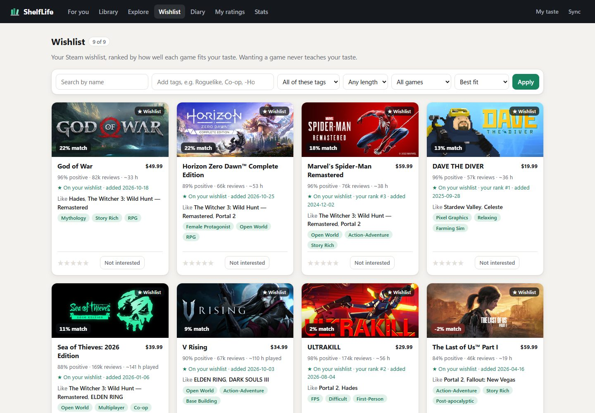
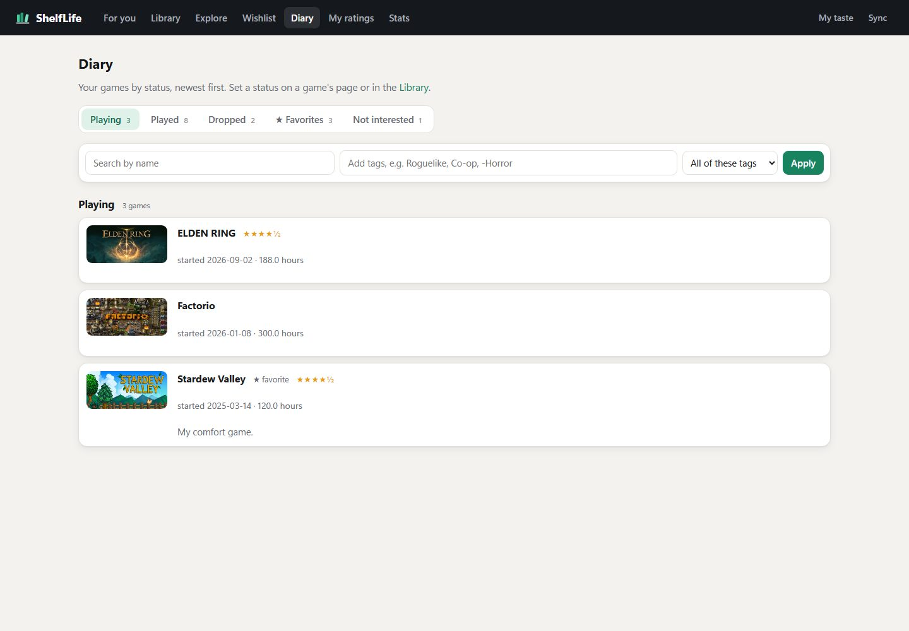
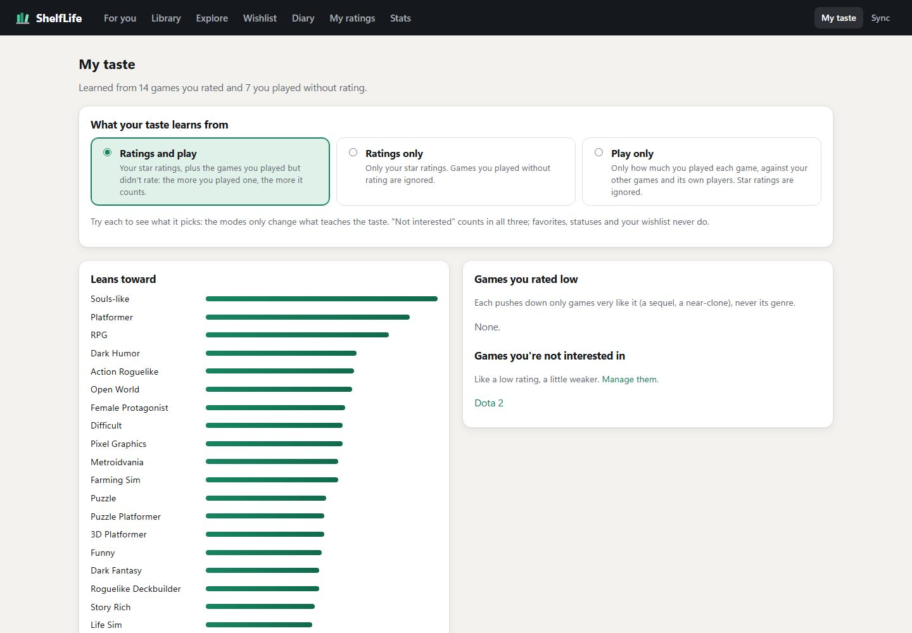
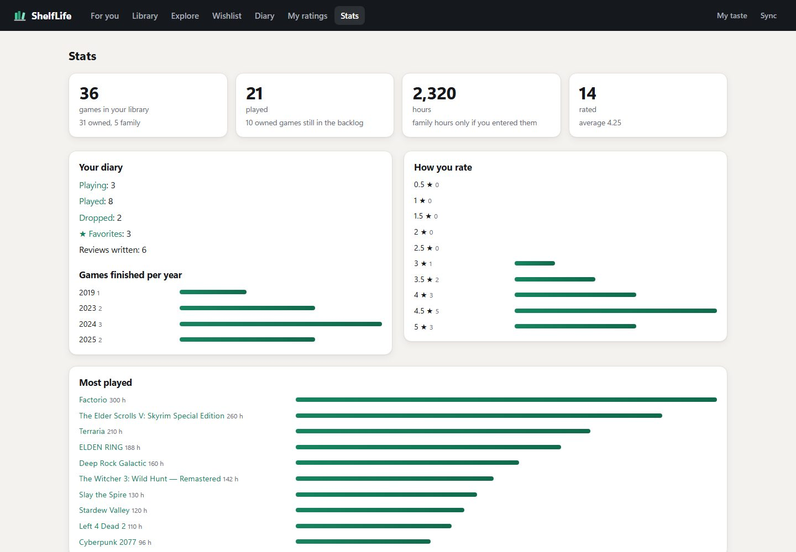

# ShelfLife

[](https://github.com/Antonetti-Lucas/shelflife/actions/workflows/tests.yml)
[](LICENSE)

> A Letterboxd-style game diary for your Steam library that learns how you *really* play and tells you what to play next.



Steam knows what you own and how long you've played, but not what you *thought* of a game, and it can't tell "I loved this 6-hour game" from "I gave up on this 150-hour RPG." ShelfLife combines your ratings with how you played each game (your hours against your other games and against the game's own players, your achievements, and when you played) into a taste it learns from your games one by one. Then it recommends games from your backlog, your Steam Family library, your wishlist and the games you don't own yet.

It runs entirely on your own computer: nothing is hosted, and your diary never leaves your machine. **Status:** early development.

## Features

- **Steam import:** your library, playtime, achievements and wishlist, plus Family Sharing games if you want them, and games you played on consoles or other stores, added by hand.
- **A diary:** half-star ratings, reviews, statuses with dates (playing, played, dropped), favorites and "not interested", with a poster wall of everything you rated.
- **Lists you make and name:** ranked or not, with your stars under each game or not, in the order you drag them into.
- **Recommendations** in four lists (backlog, family, wishlist, games to discover), each pick showing the games and tags behind it. Learn from ratings and play, ratings only, or play only.
- **Explore and find new games** by Steam tags, or "games like this one", ranked by how well they fit you.
- **Store info where you need it:** prices in your currency (kept fresh on screen), estimated length, languages, developer, release date and screenshots.
- **Stats and a taste profile**, a language filter, and a switch to hide games for adults.

## Quick start

You need Python 3.11 or newer, a Steam account and a free Steam Web API key.

**1. Install**

```bash
git clone https://github.com/Antonetti-Lucas/shelflife.git
cd shelflife
python -m venv .venv
# Windows:      .venv\Scripts\activate
# macOS/Linux:  source .venv/bin/activate
pip install -r requirements.txt
```

**2. Fill in `.env`.** Copy `.env.example` to `.env` (it's git-ignored; never share it):

```
STEAM_API_KEY=your_key_here
STEAM_ID=your_64_bit_steam_id_here
STEAM_COUNTRY=US
```

- **API key:** create one at <https://steamcommunity.com/dev/apikey> (any domain name works, e.g. `localhost`).
- **SteamID:** your 17-digit SteamID64. If your profile address has a number after `/profiles/`, that's it; otherwise paste your profile address into <https://steamid.io>.
- **Country** (optional): your two-letter country code, so prices come in your currency.
- In your Steam profile's *Privacy Settings*, set **Game details** to **Public** (and the wishlist too, if you want it read).

**3. Run, then press Sync**

```bash
python -m scripts.web
```

Open <http://127.0.0.1:8000>, go to **Sync** and press **Sync now**. It reads everything in the background, with a progress bar and a Stop button. The first sync of a few hundred games takes a while, because it's deliberately slow to respect Steam's limits; later ones only re-read what could have changed. Then use **Find more games** on Explore to add games you don't own.

## Screenshots

Taken on demo data: popular Steam games with made-up playtime, ratings and diary for an imaginary player.

| | |
|---|---|
|  **Library:** rate, set a status and sort in place |  **Explore:** games you don't own, ranked by fit, with prices and length |
|  **Game page:** why it fits you, how you played it, store details and screenshots |  **My ratings:** a poster wall you can rate on |
|  **Wishlist:** ranked by how well each game fits you |  **Diary:** playing, played, dropped, favorites |
|  **My taste:** what your taste learns from, and what it leans toward |  **Stats:** your library and diary in numbers |

## Learn more

- **[Using ShelfLife](docs/guide.md):** every page, what Sync reads, the command-line scripts, Family Sharing, and troubleshooting.
- **[How recommendations work](docs/how-it-works.md):** the play score, what your taste learns from, the model, finding new games and scoring.

## Privacy

ShelfLife has no server, no account, no analytics and no tracking.

**What it stores, and where**

- `.env`: your Steam API key and SteamID.
- `shelflife.db`: your library (games, hours, when you last played, achievement counts and when you unlocked them), your wishlist (game ids, your own rank and the date you added each), the hours you type in for family games, which games are shared with you through Family Sharing, the games you added from other platforms (which platform, and the hours you type), your diary (ratings, reviews, statuses and dates, favorites, "not interested"), your lists, your settings, and public store data for each game (names, descriptions, tags, review counts, cover addresses, five numbers summarising how long its reviewers have played it, its languages, store details and its price when last read; never who wrote a review or what it says).
- `data/`: files you create or import, such as the Family Sharing export (it lists which games your family members own, so keep it private).

All three are git-ignored. Delete them and nothing of yours is left.

**What it sends, and to whom** (only when you run a command or press a button)

- **Valve's Steam Web API** (`api.steampowered.com`): your API key and SteamID, to read your own library and achievements, and your key to look up game names. Your SteamID alone (no key) is sent to read your wishlist. Review counts, reviewers' hours, global achievement rates and tags are asked for by game id or tag alone, and a game you add from another platform by the name or link you type.
- **The Steam store** (`store.steampowered.com`) and **SteamSpy** (`steamspy.com`): game ids, tag names and your `STEAM_COUNTRY` only. They never receive your key, SteamID, ratings or diary.
- **Your browser** loads cover images and screenshots from Steam's servers when you open a page.
- Nothing else: no outside fonts, scripts or analytics. The web app listens only on `127.0.0.1`, answers only to `127.0.0.1` and `localhost` (so another website can't reach it by pointing its own name at your computer), and has no login, so don't expose it to a network.

**Steam's terms**

ShelfLife is a personal tool. Each person uses their own API key (it is personal to you, so don't share it or commit it) to read their own account, within Valve's limit of 100,000 calls a day (a full sync uses a few hundred, plus up to five review pages a game for players' hours). It follows the [Steam Web API Terms of Use](https://steamcommunity.com/dev/apiterms), which ask applications to say what Steam data they store; the list above is that statement. It is not affiliated with or endorsed by Valve.

Most of what ShelfLife reads comes from Valve's documented Web API. A few things come from endpoints Valve doesn't document: the store's `appdetails` endpoint, the reviews (counts and reviewers' hours), the store's tag and search services (`IStoreBrowseService` for games' tags, `IStoreQueryService` for the games under a tag and for finding a game by name), the tag votes on a game's store page when neither Steam nor SteamSpy has any, your wishlist (`IWishlistService`), and the Family Sharing export. They are read-only lookups, throttled and run only when you ask (the family export reads only your own account). Because they are undocumented they may change or stop working, and the [Steam Subscriber Agreement](https://store.steampowered.com/subscriber_agreement/) has a general rule about bots and scripts on Steam, whose examples are about cheating and account abuse. Using them is your choice; only the Family Sharing import is optional.

Game names, store data and cover art belong to Valve and the game publishers.

## Development

```bash
pip install -r requirements-dev.txt
python -m pytest
```

The tests use a temporary database and folder (never your own data) and can't reach the network: any call that gets past the fakes fails the test. Stack: Python, FastAPI with Jinja templates, SQLite through SQLAlchemy, pytest, GitHub Actions. The data model is in `shelflife/models.py`; after changing it, add a migration with `python -m alembic revision --autogenerate -m "what changed"` (read the file it writes), and a test checks that the migrations and the models agree. `requirements.lock` and `requirements-dev.lock` pin exact versions (regenerate with pip-tools' `pip-compile`); CI tests the newest allowed versions on Python 3.11–3.15 and the locked ones on 3.15. `python tools/evaluate.py` measures how well the taste predicts your own ratings, so a change to the scoring can be judged by numbers.

To regenerate the screenshots, `STEAM_COUNTRY=US python tools/make_demo_db.py demo.db` builds the demo database (real games, prices and reviews fetched from Steam; made-up play history, ratings, diary and wishlist), and `DATABASE_URL=sqlite:///demo.db python -m scripts.web --port 8001` runs the app on it. For the Sync page to show its buttons, also set any placeholder `STEAM_API_KEY` and `STEAM_ID` for that run; nothing is sent unless you press a button.

## License

[MIT](LICENSE). This covers the code only; data from Steam and other services stays under their own terms.
